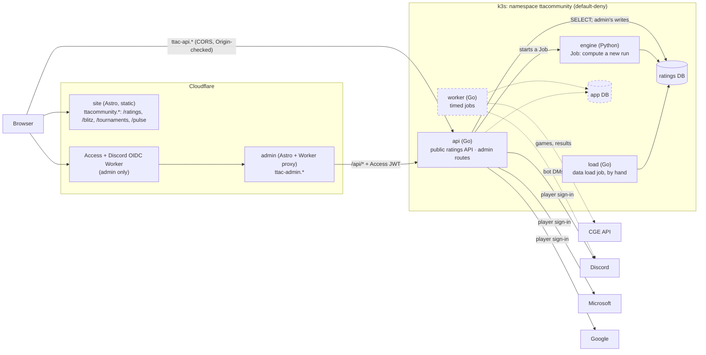
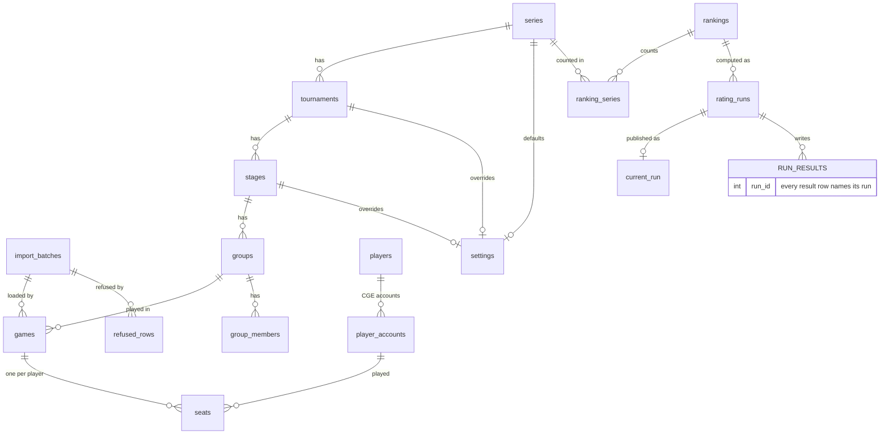

# Architecture

How the pieces fit together, what the ratings database holds, and where the
trust boundaries are. **Built:** the ratings site, its public API, admin,
the data load job and the engine; blitz tournaments' entrants (their
pairings, results and standings are being built); player sign-in with
Discord, an emailed link, Microsoft or Google. **Planned:** Tournaments, TTA Pulse, other ways to sign in,
the worker's timed jobs and the app database; they are
drawn dashed below and marked *(planned)* in the text.

## Pieces

| Piece | Role | Writes to |
|---|---|---|
| **api** | Public ratings reads (cacheable, by run), and **admin routes that accept only a valid admin-app Access JWT** (audience-pinned, fail closed), reached through admin's Worker. Starts engine runs as Kubernetes Jobs. **Player sign-in** with Discord: server-side sessions, and the signed-in player's own routes, fetched by the site alone with credentials. *(Planned: Tournaments and Pulse actions.)* | Ratings DB: admin's edits, runs started and published, through a role that can write only those; players' sign-ins, sessions and requests, through a third |
| **engine** | Reads the games, computes every model and the tournament results, and writes a **new run**. It never overwrites a published one | Ratings DB: the run's result tables |
| **load** (`cmd/load`) | The data load job, run by hand: restores a baseline export, loads match CSVs, CGE's games and recorded facts, applies migrations, exports. It validates every row and records what it refuses | Ratings DB input tables |
| **site, admin** | Astro, built and hosted by Cloudflare from `main` (previews from `dev`). One public site with sections, and admin on its own host behind Access. Types generated from the OpenAPI spec | nothing |
| **worker** *(planned)* | Everything that happens *at a time*: reminders, kick-offs, rounds, the outbox. **Exactly one acts at a time** (a Postgres advisory lock), so a rollout cannot start a game twice. A stub today | app DB |

**Separate roles per purpose.** Public routes read the ratings DB through a
`SELECT`-only login, so a bug in a public endpoint cannot write ratings.
Admin's writes go through a second login that can change only what admin
edits, and sign-in's through a third that can change only players'
sign-ins, sessions and requests, and a linked member's own country and zone.
They live in the ratings DB beside the members they link to. The app DB
*(planned)* holds matches, apart from the ratings.

## Data flow for ratings

**games** (a baseline restore, match CSVs, or CGE's own records, through the
load job) → **import batch** (validated; duplicates, renamed players and junk
are matched or *refused*, never silently kept) → **run**, started from admin
(the api creates a Job from the engine's CronJob) or by hand → **published**
from admin once its checks pass (a one-row switch) → the API serves it, and
Cloudflare caches each response until the next publish. The seat analysis,
which reads every seat of a run, is computed on the run's first request and
kept in the api's memory, so a corrected result shows there from the next run
(or the api's next restart).

### Rating runs

The engine never changes the ratings people are reading. Each recompute
writes a whole **run**, and every result table (ratings, history,
calibration) carries its `run_id`. A single row, `current_run`, names the run
the API serves. Publishing is changing that row in one transaction, and
rolling back is pointing it at the previous run. Only a run whose checks
passed (`status = 'complete'`) can be current: the schema refuses anything
else.

A run records its **cause**: the engine version and a fingerprint of the
input matches. A few recent runs are kept, so two can be compared before
one is published.

**Games on the same day are processed in chronological order**, because
GlickoD sets a newcomer's starting rating from their first 15 games. The engine
orders games by date, then by CGE's finish time (`finished_at`) when known,
breaking ties and pre-CGE games (date only) by load order (`match_id`).

**Tournament results** (standings, podiums, Hall of Fame, each player's
achievements) are derived by the engine from matches and the tournament
rules. Organisers record what matches
cannot show, such as seeding and official rulings, in the admin site, scoped
to the series they run.

## The ratings database

PostgreSQL. **The exact schema is
[`backend/migrations/ratings/00001_schema.sql`](../backend/migrations/ratings/00001_schema.sql)**
(every table, function, index, grant and starting row), plus any numbered
migration after it (goose, plain SQL). To see the tables, apply them to an
empty database (`go run ./cmd/load -migrate`) and use `\d` in `psql`. A
database is rebuilt from scratch from an export (README, "Rebuild a
database from scratch"). What follows is the shape, which changes only when
a new kind of data arrives.

A **series** (International, World Championship) holds **tournaments** (a
season or a year), each in **stages**, each in **groups** of **games**. A
**seat** is one player in one game: their culture (never negative), their
**place** (finishers by CGE's standing, then resigners, the last to resign
highest, then timed-out players, tied last) and how they finished. A
**setting** (points per place, time-out penalty, tiebreakers) sits on a
series and may be overridden by a tournament or a stage. Two views put this
together: `stage_settings` (each stage's settings, resolved) and
`game_lines` (one row per game, its seats in seat order and each seat's game
points). The engine rates who placed above whom, and scores standings from
game points.

The tables fall into five groups:

| Group | What it holds | Tables (examples) | Written by |
|---|---|---|---|
| **Games** | Every game and its seats: players, culture, place, outcome, CGE game, account and times; its state (played, never played, unconfirmed, running, prepared). The input to every run | `games`, `seats`, `players`, `player_accounts`, `import_batches`, `refused_rows` | load job |
| **Catalogue and recorded facts** | Series, tournaments, stages and groups with their settings; what counts towards which ranking; and what games cannot say: official placements, divisions, podium and title overrides, rules, notes, cards, regulations, stories, CGE's own standings, community points | `series`, `tournaments`, `stages`, `groups`, `settings`, `rankings`, `ranking_series`, `cge_tournaments`, `tournament_official_placements`, `tournament_cards`, `community_scores`, `badges` | load job, admin |
| **Runs** | One row per computation: its ranking, engine version, input fingerprint, status, progress, whether it is protected; and which run each ranking publishes | `rating_runs`, `run_progress`, `current_run` | engine, admin |
| **Run results** | Everything a run computes, each row keyed by `run_id`: ratings and history per model and format, the 1v1 pairs, each player's record per format and year, calibration, titles, tournament standings, boards, records and achievements, the community leaderboard | `player_ratings`, `rating_history`, `pairwise_matches`, `player_year_records`, `player_titles`, `tournament_standings`, `tournament_records`, `community_rankings` | engine |
| **Admin** | Who may use admin and with which role; an audit of every admin change | `admins`, `admin_audit` | admin |

Patterns that hold across the schema:

- **Runs, not overwrites.** A result table never changes a published run's
  rows; deleting a run deletes its results with it (the foreign keys
  cascade). A protected run cannot be deleted
- **Facts are keyed by name** (tournament or series, season, player), not by
  foreign keys to games, so a recorded fact survives a re-import of the games
- **The export is the import.** Every input table (Games, Catalogue and
  recorded facts, admin's settings) is exported as CSV with a manifest
  (`go run ./cmd/load -export`, or **Download all data** in admin) and
  restored whole by `-restore`. Personal data (`admins`, `admin_audit`, the
  blitz tables with their Discord names, players' sign-ins, sessions and
  requests) and `refused_rows` are left out, and a test enforces it
- **Roles:** `ratings` owns the schema (load job, engine); `ratings_read`
  may only `SELECT` (the api's public routes); `ratings_admin` may write
  only admin's tables (the api's admin routes); `ratings_player` may write
  only sign-ins, sessions, requests to be linked and a linked member's
  country and zone (the api's player routes). Anything more a player may
  do, such as reporting their own blitz game, is a `SECURITY DEFINER`
  function granted to `ratings_player` alone, which checks the session and
  that format's rules before it writes; the shared writer behind it,
  `write_game`, is granted to nobody. A linked member's empty Discord name
  and email are filled from their account's sign-ins
  (`fill_member_from_logins`, for both the player and admin logins); what
  the member has is never replaced. The api checks each login's limits
  when it starts, and refuses to serve with one that can do more

The **app database** *(planned)* will hold tournament
matches, the Pulse queue and the notification outbox, with its own
migrations in `backend/migrations/app/`.

## Site content

Text pages and cards (the FAQ, the methodology, the analysis commentary)
are MDX files in `web/site/src/content/`, changed by pull request. MDX is
used across the whole site so there is one way to write content: Markdown
for prose, maths in `$…$` rendered to MathML by KaTeX at build (no maths
script in the browser), and HTML with classes or small components where a
page needs styled boxes or tables. A new page is a new file.
Interactive parts write maths the same way, as TeX, through a small
`<Tex>` component that runs the same KaTeX in the browser.

### Blitz tournaments

A blitz tournament is an ordinary tournament whose series has the **Blitz**
setting: organisers run it from admin's Blitz tab, a round a week, in the
format CGE's US Open uses (Swiss rounds, then a knockout). Admin holds each
edition's format and tiebreak seed (`blitz_editions`), its entrants
(`blitz_entries`: a member, in or dropped, shown on the site once
entered), added one at a time by searching the members and the players the ratings know (a player
who is no member yet becomes one, in the ratings' spelling), and its rounds (`blitz_rounds`, `blitz_matches`):
paired by the api (`internal/blitz`: equal points, never the same opponent
twice, the best time-zone fit within a score group, the bye to the lowest
in the standings without one), changed by hand, then published. A Swiss
pairing never repeats: when the score groups leave players who have all
met, the whole field is searched for a round without a repeat, and a round
that cannot avoid one is refused (fewer Swiss rounds then go on to the
knockout). Admin warns when the Swiss rounds pass half the active entrants,
the most that can always be paired. Pairing a
round already made pairs only the players it leaves out, keeping the rest
as they are, so a late entrant joins a round still in play. An entrant who
has played (a result, or a bye in a published round) and withdraws is
dropped: their results stand and they are not paired again. One who has
not played is removed instead, coming out of the Swiss round they are
paired in and leaving their opponent for Pair to fill in. An entrant may
skip the next Swiss round (`blitz_skips`, by round number, so the round can
be deleted and paired again without them): they are left out of its
pairing and score the edition's skip points for it, and the site lists
them under the round.

**A result is a game.** A played game is written to `games` and `seats`
under the edition's stage "Round N", from an `import_batches` row of
source `admin`, with the time it finished (entered on the clocks of a zone
or region, stored in UTC; its `date` is that time's UTC day, as for the
games CGE's data brings), so the tournament's page shows it at once and a later CGE
extract load matches it by share code instead of adding a copy (a game
recorded without a code has nothing to match it by); recording
the match again corrects that one game. Every result gives each player's
turn, stored as the seat's `starting_position` (0 for who went first), so
game lines and seat figures follow the order they played in; a game
recorded before turn order was asked for has none, and counts in pairing
order until an organiser adds it. A result in the latest round can
be reset, a match's or the whole round's: the game goes with its seats and
batch, through `delete_blitz_game`, since the admin login cannot delete
games itself. Resetting the edition removes every round and game and puts
everyone back in. A ratings run that included a game reset loses its rows
for it, and is made again to bring its pages up to date. The match keeps the result (a win,
a draw or a double loss) and, when the organisers decided it instead, their
ruling and its reason (a ruling may overrule a played game). The next round
is paired only once every match has a result. The standings are computed
on read from the published Swiss rounds (`internal/blitz`, the same for
admin and the site): points, then the tie-breaks of
[FIDE's regulations](https://handbook.fide.com/chapter/TieBreakRegulations032026)
for Swiss tournaments, Direct Encounter (Article 6) and then Buchholz
(8.1), with unplayed rounds counted as Article 16 says (a bye, a forfeit or
a round not paired is a game against a dummy with the player's own score; an
opponent's rounds after dropping out count as draws), and last a draw from
the edition's seed. A result the organisers ruled with no game played is a
forfeit; a resignation or timeout is a played game. For this the
admin login may insert and update games, seats, players and stages; it
still cannot delete games, players or runs, and the api refuses to start
if it could.

**The knockout** follows the last Swiss round, and the same Pair makes it:
the top of the standings, the best seed against the worst, then each
round's winners until the final. Each knockout match keeps its place in
the bracket (`blitz_matches.slot`): the winners of slots 2k and 2k+1 meet
in slot k of the next round. It also keeps its players' seeds, their
places in the Swiss standings when the knockout began, so a later
correction to a Swiss result never moves the bracket. A knockout round
follows the bracket, so it is never changed by hand, and it may repeat a
Swiss pairing; the one exception is a player who dropped from a match still
to play, whom the round's reserve (the best Swiss place among active
entrants not in it) or a wildcard (an entrant, or anyone entered on the
spot) replaces in the same slot with the same seed. A knockout match needs a winner: a drawn game stays a draw
as a game and sends the higher seed through, and a ruling there names the
winner. The standings count the Swiss rounds only. The champion is
the winner of the published final, worked out on read; once the knockout
has a round, the edition's format no longer changes.

The site's `/blitz` shows the editions, each one's knockout and champion,
its standings, the published Swiss pairings with their results, and who is
in, each with their country's flag. A ruling's reason stays in admin.

Blitz belongs to the root site, not to the ratings: the header on the home
page and `/blitz` lists the root site's sections (Ratings, Blitz), and
everything under `/ratings/` keeps the ratings' own menu and footer.

### Members

Everyone who takes part in anything the community runs is a **member**
(`members`), apart from the ratings' `players`, which the engine's data
alone defines. A member is keyed by their TTA username exactly as in the
app, unique without case; the CGE account (`cge_user`) and ratings player
(`player_id`) are attached as they become known. Adding a member whose
name a CGE account or the ratings know takes their spelling and their ids;
after every data load the load job matches members to the accounts and
players it brought by name, and renames a member with an account to that
account's current name, so a CGE rename follows through. Admin may enter a
CGE id by hand. The ratings never make or change a player from a member.

A member also carries a Discord name, an email (so organisers can reach
players who have no Discord), a country (one of ISO 3166's two-letter
codes, or XK for Kosovo; the site has a flag for each, from
[Flagpedia](https://flagpedia.net), whose flags are public domain), a time
zone (an IANA zone; until that is known, a region such as US East, which
keeps one of its cities' time, or Unknown, paired as UTC), and a
**community ban** with its reason, which stops them being entered in an
edition and leaves their games and ratings alone. Admins and organisers
add and edit members; bans and removals are admins' only, and a member in
an edition cannot be removed. Blitz entrants are members: an entry holds
only the edition, the status and a `member_id`.

**Personal data never leaves admin**: the public role has no `SELECT` on a
member's Discord name, email or ban, so no public route can read them, and
the export leaves `members` and the blitz tables out.

### Player sign-in

A player signs in on the site with Discord (scope `identify`: their id,
username and display name, never their email). Each way a player signs in
is a **login** (`logins`): the provider, its id for them, their names
there, and the member it is linked to. A login is linked to a member in
one of two ways:

- **By the recorded Discord name**: at sign-in, a login not yet linked is
  linked to the one member whose recorded Discord name is its username
  (ignoring case and a leading @), unless that member is banned or already
  has a Discord login
- **By approval**: otherwise the player asks to be linked to their TTA
  username (`link_requests`), and an admin or organiser approves it
  (linking the member that name names, or adding one) or refuses it with a
  reason the player sees

A login an admin unlinks is not linked by name again. A banned member's
login cannot sign in.

A player can also sign in with **any Microsoft account**, personal, work or
school (scopes `openid profile email`). The api checks the ID token itself:
Microsoft's signature, this app's audience, expiry, the nonce, and an issuer
naming the token's own tenant. The login is keyed by `sub`, Microsoft's id
for the account in this app alone, and keeps the account's name, and its
email when Microsoft vouches for it: a personal account's, which Microsoft
made it prove, or a work or school account's whose domain its directory
verified (`xms_edov`).
A player can sign in with **a Google account** the same way (scopes `openid
email profile`): Google's signature, this app's audience, expiry, the nonce,
and Google as the issuer. The login is keyed by `sub`, the account's Google
id, and keeps its name, and its email when Google has verified it
(`email_verified`).
Either email is for writing to the player: it never links a login to a
member, though it fills a linked member's empty email like an email
login's address. Sessions (`player_sessions`) are server-side: the
browser holds an opaque token in a cookie on the API host, and the database
only its hash; a session ends at sign-out or after 30 days unused. A
player sets their own country and time zone: on their member once linked,
until then on the login, where whoever answers the request sees them, and
the link moves them to the member. A first sign-in opens the account page
to add these details; later ones go straight back to the page signed in
from. A signed-in admin or
organiser is shown the way to admin, which still checks Access.

### Tournaments: data, not code

Everything that differs between tournaments is a row that admin edits, so
a new or renamed tournament needs no code change:

- **What it is**: `tournaments.kind` (league, cup or ladder) and, for a
  league, `top_divisions`, whose final standings make its podium
- **How it presents itself**: its card (icon, short description,
  information box, page subtitle, cadence), Format & Regulations, and
  stories
- **What counts towards ratings**: the tournament, each season, and the
  player counts rated
- **Where it came from**: tournaments, seasons and stages keep an
  `original_name`, the name they were imported with, so renamed data can
  still be matched against new imports

Every tournament page is the same components in the same order: the
header (`TournamentHero`), Format & Regulations beside the Trophyboard,
stories, highest scores, one Stages panel and one "Champions & Seasons"
table. The cards on the Hall of Fame and Every Tournament are one
`TournamentCard`. A panel with nothing to show is left out rather than
switched off per tournament.

Hard-coded content is limited to what is not one tournament's: the Hall of
Fame's own text and its circuits (Grand Slams, Ladders), which group
several tournaments.

### Look and type

The ratings site keeps DANeo's design. What is shared lives in two places:

- **Tokens** in `web/shared/styles/tokens.css`: the four font families (Cinzel
  for titles and table headers, Marcellus for buttons and labels, Source Serif
  for reading, Inter for numbers), the colours, the gold gradient, and a text
  size for each role (page title, card title, subheading, body, table header,
  table cell, label). Use a token before writing a new value
- **Components** for anything that appears on more than one page:
  `Segmented` (a row of buttons choosing one value, in each page's look),
  `SearchBox`, `FilterInput`, `PlayerLink`, `ScrollTable`, `Waiting` (loading
  and could-not-load messages), `TournamentCard` and `TournamentHero`

A page's own decoration (a hero, a banner, a badge's colours) stays in that
page's stylesheet.

### Web tests

Tests cover what the page does, not how it looks. A component stays thin:
its decisions (what to show, in what order, which fallback) live in a
function in `lib/` with a Vitest test. There are no render or DOM tests,
so a change to markup, styling or wording changes no test.

## The community's data outlives the site

Every input table can be exported as CSV and restored whole (see [the
ratings database](#the-ratings-database)): **the export format is the import
format**, and **it contains no personal data**. Today the maintainers keep
baselines in a private data repository. *(Planned: the worker publishes
exports on a schedule to a public data repository, so anyone can rebuild an
instance from the public backup alone.)* Operational backups, which hold
personal data, are separate and private.

## Time

Instants are `timestamptz` in UTC, and each player has an **IANA timezone**
name, never an offset. The browser's timezone only pre-fills the setup form.
Times are rendered in the viewer's zone.

## Notifications *(planned)*

An **outbox** row is written in the same transaction as its cause. The worker
sends it and records the result. A crash between those steps causes at worst a
duplicate, never a lost message. Channels are a Discord DM from the bot on the
TTA community server and email via `mail-relay`.

## Trust boundaries

- **Admin is behind Cloudflare Access**, signed in with Discord through
  our own OIDC Worker; the api verifies the Access JWT on every admin
  request, and an admin's role (admin, organiser) is checked there. The
  public site and API need no sign-in
- **Player sign-in proves a Discord identity**: the authorization code
  flow with `state` and PKCE; anything wrong leaves the player signed out.
  The session cookie is opaque, host-only, `HttpOnly`, `Secure` and
  `SameSite=Lax`, and the Discord token is not kept. **The TTA username is
  linked by name or by approval** (above), not proven: a proof by email to
  the address CGE holds waits on CGE's API.
- **The player routes answer the site alone**: CORS with credentials for
  the site's exact origin, never `*`, and never cached.
- **CSRF:** the sites and the API are same-site, so `SameSite` does not
  protect. Every state-changing request checks `Origin`.
- **Egress:** default-deny. The api reaches only public HTTPS (Cloudflare
  Access's signing keys, Discord's OAuth) and the Kubernetes API (to start
  engine Jobs); the worker
  *(planned)* will reach CGE and Discord. RFC1918 ranges are excluded.
- **Personal data** (Discord id and handle, optional email, TTA username,
  timezone) is **never logged at any level**. A reported error is found by
  the random request id the API sets on every answer (`X-Request-Id`);
  people see it as "ref …" in a server error's message.
- **Metrics** are served on a port of their own that the tunnel does not
  reach, and only the cluster's Prometheus may connect to it. They name
  route patterns and status codes, never a path.
- **Analytics:** the public site allows the beacon Cloudflare injects for
  its Web Analytics (`https://static.cloudflareinsights.com/beacon.min.js/`
  in the CSP's `script-src`, trailing slash included, since the beacon's
  path continues past it); it reports to the site's own origin. Cloudflare
  states that Web Analytics "does not collect or use your visitors'
  personal data" ([Cloudflare Web
  Analytics](https://developers.cloudflare.com/web-analytics/about/))

## What it sits on

A home k3s cluster: four Pi 4s (arm64) and two amd64 machines, with
Longhorn storage, Flux, and the GitHub Actions runners CI uses. Flux applies
`deploy/` from `main`, as an account that can change only the `ttacommunity`
namespace. The database and the engine run on the larger amd64 machine. TLS
terminates at Cloudflare, and traffic arrives through a cloudflared tunnel.
Images are built by CI into GitHub's container registry and pinned by
digest in `deploy/`.
