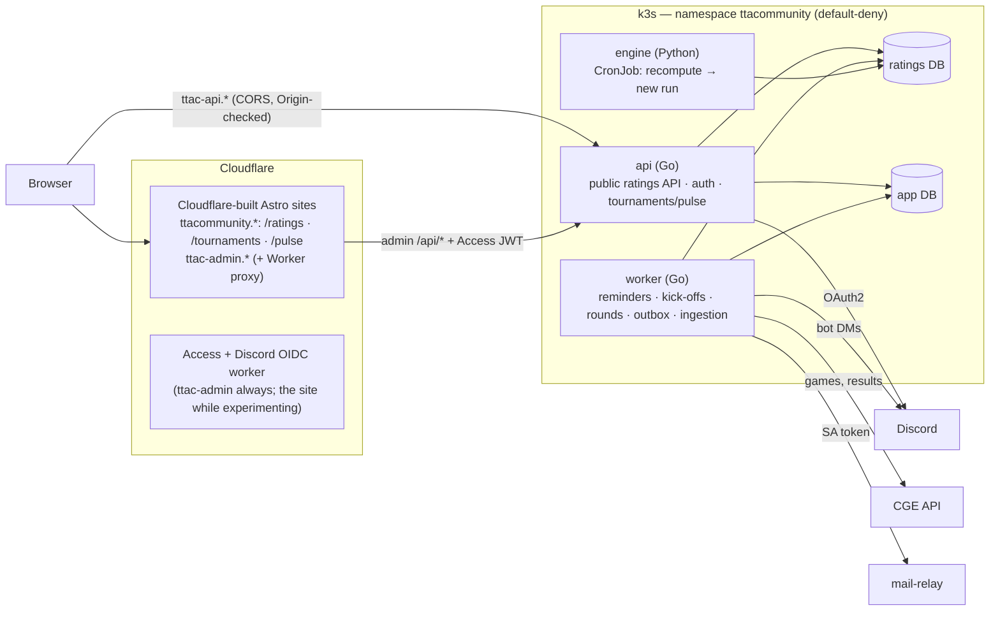

# Architecture

**Draft.** How the pieces fit together, and where the trust boundaries are.

## Pieces

| Piece | Role | Writes to |
|---|---|---|
| **api** | Public ratings reads, Discord sign-in, Tournaments/Pulse actions, and **admin routes that accept only a valid admin-app Access JWT** (audience-pinned, fail closed), reached through the admin site's Worker | app DB. Ratings DB **import batches and recompute requests** (admin routes only) |
| **worker** | Everything that happens *at a time*. **Exactly one acts at a time** (a Postgres advisory lock), so a rollout cannot start a game twice. | app DB. Ratings DB import batches (CGE ingestion, later) |
| **engine** | Reads matches, computes all models, and writes a **new run**. It never overwrites a published run | Ratings DB result tables only |
| **site, admin** | Astro, built and hosted by Cloudflare from git. One public site with sections, and admin on its own host behind Access. Types generated from the OpenAPI spec | nothing |

**Two databases with separate roles.** The public read path uses a read-only
role on the ratings DB, so a bug in a public endpoint cannot write ratings.

## Data flow for ratings

`upload (now) / CGE API (later)` → **import batch** (validated, duplicates
removed, aliases resolved, junk *refused* rather than warned) →
**recompute request** → engine job → **new run** → **published** once its
checks pass (a one-row switch) → API serves it, and Cloudflare caches until the next publish.

### Rating runs

The engine never changes the ratings people are reading. Each recompute
writes a whole **run**, and every result table (ratings, history,
calibration) carries its `run_id`. A single row, `current_run`, names the run
the API serves. Publishing is changing that row in one transaction, and
rolling back is pointing it at the previous run. Only a run whose checks
passed (`status = 'complete'`) can be current: the schema refuses anything
else.

A run records its **cause**: the engine version and a fingerprint of the
input matches. A few recent runs are kept, so two can be compared before
one is published.

**Games on the same day are processed in a fixed order**, because dates carry
no time and GlickoD sets a newcomer's starting rating from their first 15
games. The engine uses the order of the original site's match file: games
grouped by tournament (Royal League, Worlds, Mercurial…, by name prefix), each
group by date, and the groups by their first date. With it, the ratings
match the original site's engine on the same games.

**Tournament results** (standings, podiums, Hall of Fame, each player's
achievements) are derived by the engine from matches and the tournament
rules. Organisers record what matches
cannot show, such as seeding and official rulings, in the admin site, scoped
to the series they run.

## Site content

Text pages and cards (the FAQ, the methodology, the analysis commentary)
are MDX files in `web/site/src/content/`, changed by merge request. MDX is
used across the whole site so there is one way to write content: Markdown
for prose, maths in `$…$` rendered to MathML by KaTeX at build (no maths
script in the browser), and HTML with classes or small components where a
page needs styled boxes or tables. A new page is a new file.
Interactive parts write maths the same way, as TeX, through a small
`<Tex>` component that runs the same KaTeX in the browser.

### Tournaments: data, not code

Everything that differs between tournaments is a row that admin edits, so
a new or renamed tournament needs no code change:

- **What it is**: `tournaments.kind` (league, cup or ladder) and, for a
  league, `top_divisions`, whose final standings make its podium
- **How it presents itself**: its card (icon, short description,
  information box, page subtitle, cadence), Format & Regulations, and
  stories
- **What counts towards ratings**: the tournament, each season, and the
  player counts rated
- **Where it came from**: tournaments, seasons and stages keep an
  `original_name`, the name they were imported with, so renamed data can
  still be matched against new imports

Every tournament page is the same components in the same order: the
header (`TournamentHero`), Format & Regulations beside the Trophyboard,
stories, highest scores, one Stages panel and one "Champions & Seasons"
table. The cards on the Hall of Fame and Every Tournament are one
`TournamentCard`. A panel with nothing to show is left out rather than
switched off per tournament.

Hard-coded content is limited to what is not one tournament's: the Hall of
Fame's own text and its circuits (Grand Slams, Ladders), which group
several tournaments.

### Look and type

The ratings site keeps DANeo's design. What is shared lives in two places:

- **Tokens** in `web/shared/styles/tokens.css`: the four font families (Cinzel
  for titles and table headers, Marcellus for buttons and labels, Source Serif
  for reading, Inter for numbers), the colours, the gold gradient, and a text
  size for each role (page title, card title, subheading, body, table header,
  table cell, label). Use a token before writing a new value
- **Components** for anything that appears on more than one page:
  `Segmented` (a row of buttons choosing one value, in each page's look),
  `SearchBox`, `FilterInput`, `PlayerLink`, `ScrollTable`, `Waiting` (loading
  and could-not-load messages), `TournamentCard` and `TournamentHero`

A page's own decoration (a hero, a banner, a badge's colours) stays in that
page's stylesheet.

### Web tests

Tests cover what the page does, not how it looks. A component stays thin:
its decisions (what to show, in what order, which fallback) live in a
function in `lib/` with a Vitest test. There are no render or DOM tests,
so a change to markup, styling or wording changes no test.

## The community's data outlives the site

The worker exports the community's data (matches, tournaments, results,
published ratings) as CSV on a schedule to a public data repository, whose
releases are archived independently. **The export format is the import
format**, so anyone can rebuild an instance from the public backup alone.
**It contains no personal data.** Operational backups, which do, are
separate and private.

## Time

Instants are `timestamptz` in UTC, and each player has an **IANA timezone**
name, never an offset. The browser's timezone only pre-fills the setup form.
Times are rendered in the viewer's zone.

## Notifications

An **outbox** row is written in the same transaction as its cause. The worker
sends it and records the result. A crash between those steps causes at worst a
duplicate, never a lost message. Channels are a Discord DM from the bot on the
TTA community server and email via `mail-relay`.

## Trust boundaries

- **Sign-in proves a Discord identity.** A TTA username is a *claim* until it
  is confirmed by email to the address CGE holds. Unverified players
  cannot act on CGE matches.
- **CSRF:** the sites and the API are same-site, so `SameSite` does not
  protect. Every state-changing request checks `Origin`.
- **Egress:** only `worker` and `api` (for the OAuth token exchange) reach the
  internet, and RFC1918 ranges are excluded.
- **Personal data** (Discord id and handle, optional email, TTA username,
  timezone) is **never logged at any level**.
- **Analytics:** the public site allows the beacon Cloudflare injects for
  its Web Analytics (`https://static.cloudflareinsights.com/beacon.min.js/`
  in the CSP's `script-src`, trailing slash included, since the beacon's
  path continues past it); it reports to the site's own origin. Cloudflare
  states that Web Analytics "does not collect or use your visitors'
  personal data" ([Cloudflare Web
  Analytics](https://developers.cloudflare.com/web-analytics/about/))

## What it sits on

The home k3s cluster managed by `picluster`: four Pi 4s (arm64) and
`unstableserver`/`wsl-laptop` (amd64), with Longhorn, Flux and the GitLab
runners. Both databases and the engine are pinned to **`unstableserver`**,
because the upstream DB is ~1.4 GB (unmeasured) and the engine is numpy-heavy.
TLS terminates at Cloudflare, and traffic arrives through a cloudflared tunnel.
