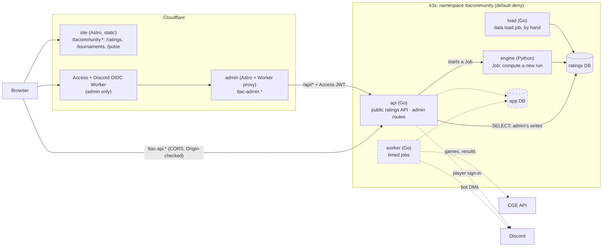

# Architecture

How the pieces fit together, what the ratings database holds, and where the
trust boundaries are. **Built:** the ratings site, its public API, admin,
the data load job and the engine. **Planned:** Tournaments, TTA Pulse,
player sign-in, the worker's timed jobs and the app database; they are
drawn dashed below and marked *(planned)* in the text.

## Pieces

| Piece | Role | Writes to |
|---|---|---|
| **api** | Public ratings reads (cacheable, by run), and **admin routes that accept only a valid admin-app Access JWT** (audience-pinned, fail closed), reached through admin's Worker. Starts engine runs as Kubernetes Jobs. *(Planned: player sign-in with Discord, Tournaments and Pulse actions.)* | Ratings DB: admin's edits, runs started and published, through a role that can write only those |
| **engine** | Reads the games, computes every model and the tournament results, and writes a **new run**. It never overwrites a published one | Ratings DB: the run's result tables |
| **load** (`cmd/load`) | The data load job, run by hand: restores a baseline export, loads match CSVs, CGE's games and recorded facts, applies migrations, exports. It validates every row and records what it refuses | Ratings DB input tables |
| **site, admin** | Astro, built and hosted by Cloudflare from `main` (previews from `dev`). One public site with sections, and admin on its own host behind Access. Types generated from the OpenAPI spec | nothing |
| **worker** *(planned)* | Everything that happens *at a time*: reminders, kick-offs, rounds, the outbox. **Exactly one acts at a time** (a Postgres advisory lock), so a rollout cannot start a game twice. A stub today | app DB |

**Separate roles per purpose.** Public routes read the ratings DB through a
`SELECT`-only login, so a bug in a public endpoint cannot write ratings.
Admin's writes go through a second login that can change only what admin
edits. The app DB *(planned)* holds players, sessions and matches, apart
from the ratings.

## Data flow for ratings

**games** (a baseline restore, match CSVs, or CGE's own records, through the
load job) → **import batch** (validated; duplicates, renamed players and junk
are matched or *refused*, never silently kept) → **run**, started from admin
(the api creates a Job from the engine's CronJob) or by hand → **published**
from admin once its checks pass (a one-row switch) → the API serves it, and
Cloudflare caches each response until the next publish. The seat analysis,
which reads every seat of a run, is computed on the run's first request and
kept in the api's memory, so a corrected result shows there from the next run
(or the api's next restart).

### Rating runs

The engine never changes the ratings people are reading. Each recompute
writes a whole **run**, and every result table (ratings, history,
calibration) carries its `run_id`. A single row, `current_run`, names the run
the API serves. Publishing is changing that row in one transaction, and
rolling back is pointing it at the previous run. Only a run whose checks
passed (`status = 'complete'`) can be current: the schema refuses anything
else.

A run records its **cause**: the engine version and a fingerprint of the
input matches. A few recent runs are kept, so two can be compared before
one is published.

**Games on the same day are processed in a fixed order**, because dates carry
no time and GlickoD sets a newcomer's starting rating from their first 15
games. The engine uses the order of the original site's match file: games
grouped by tournament (Royal League, Worlds, Mercurial…, by name prefix), each
group by date, and the groups by their first date. With it, the ratings
match the original site's engine on the same games.

**Tournament results** (standings, podiums, Hall of Fame, each player's
achievements) are derived by the engine from matches and the tournament
rules. Organisers record what matches
cannot show, such as seeding and official rulings, in the admin site, scoped
to the series they run.

## The ratings database

PostgreSQL. **The exact schema is
[`backend/migrations/ratings/00001_schema.sql`](../backend/migrations/ratings/00001_schema.sql)**
(every table, function, index, grant and starting row), plus any numbered
migration after it (goose, plain SQL). To see the tables, apply them to an
empty database (`go run ./cmd/load -migrate`) and use `\d` in `psql`. A
database is rebuilt from scratch from an export (README, "Rebuild a
database from scratch"). What follows is the shape, which changes only when
a new kind of data arrives.

A **series** (International, World Championship) holds **tournaments** (a
season or a year), each in **stages**, each in **groups** of **games**. A
**seat** is one player in one game: their culture (never negative), their
**place** (finishers by CGE's standing, then resigners, the last to resign
highest, then timed-out players, tied last) and how they finished. A
**setting** (points per place, time-out penalty, tiebreakers) sits on a
series and may be overridden by a tournament or a stage. Two views put this
together: `stage_settings` (each stage's settings, resolved) and
`game_lines` (one row per game, its seats in seat order and each seat's game
points). The engine rates who placed above whom, and scores standings from
game points.

The tables fall into five groups:

| Group | What it holds | Tables (examples) | Written by |
|---|---|---|---|
| **Games** | Every game and its seats: players, culture, place, outcome, CGE game, account and times; its state (played, never played, unconfirmed, running, prepared). The input to every run | `games`, `seats`, `players`, `player_accounts`, `import_batches`, `refused_rows` | load job |
| **Catalogue and recorded facts** | Series, tournaments, stages and groups with their settings; what counts towards which ranking; and what games cannot say: official placements, divisions, podium and title overrides, rules, notes, cards, regulations, stories, CGE's own standings, community points | `series`, `tournaments`, `stages`, `groups`, `settings`, `rankings`, `ranking_series`, `cge_tournaments`, `tournament_official_placements`, `tournament_cards`, `community_scores`, `badges` | load job, admin |
| **Runs** | One row per computation: its ranking, engine version, input fingerprint, status, progress, whether it is protected; and which run each ranking publishes | `rating_runs`, `run_progress`, `current_run` | engine, admin |
| **Run results** | Everything a run computes, each row keyed by `run_id`: ratings and history per model and format, the 1v1 pairs, calibration, titles, tournament standings, boards, records and achievements, the community leaderboard | `player_ratings`, `rating_history`, `pairwise_matches`, `player_titles`, `tournament_standings`, `tournament_records`, `community_rankings` | engine |
| **Admin** | Who may use admin and with which role; an audit of every admin change | `admins`, `admin_audit` | admin |

Patterns that hold across the schema:

- **Runs, not overwrites.** A result table never changes a published run's
  rows; deleting a run deletes its results with it (the foreign keys
  cascade). A protected run cannot be deleted
- **Facts are keyed by name** (tournament or series, season, player), not by
  foreign keys to games, so a recorded fact survives a re-import of the games
- **The export is the import.** Every input table (Games, Catalogue and
  recorded facts, admin's settings) is exported as CSV with a manifest
  (`go run ./cmd/load -export`, or **Download all data** in admin) and
  restored whole by `-restore`. Personal data (`admins`, `admin_audit`) and
  `refused_rows` are left out, and a test enforces it
- **Roles:** `ratings` owns the schema (load job, engine); `ratings_read`
  may only `SELECT` (the api's public routes); `ratings_admin` may write
  only admin's tables (the api's admin routes)

The **app database** *(planned)* will hold players, sessions, tournament
matches, the Pulse queue and the notification outbox, with its own
migrations in `backend/migrations/app/`.

## Site content

Text pages and cards (the FAQ, the methodology, the analysis commentary)
are MDX files in `web/site/src/content/`, changed by pull request. MDX is
used across the whole site so there is one way to write content: Markdown
for prose, maths in `$…$` rendered to MathML by KaTeX at build (no maths
script in the browser), and HTML with classes or small components where a
page needs styled boxes or tables. A new page is a new file.
Interactive parts write maths the same way, as TeX, through a small
`<Tex>` component that runs the same KaTeX in the browser.

### Tournaments: data, not code

Everything that differs between tournaments is a row that admin edits, so
a new or renamed tournament needs no code change:

- **What it is**: `tournaments.kind` (league, cup or ladder) and, for a
  league, `top_divisions`, whose final standings make its podium
- **How it presents itself**: its card (icon, short description,
  information box, page subtitle, cadence), Format & Regulations, and
  stories
- **What counts towards ratings**: the tournament, each season, and the
  player counts rated
- **Where it came from**: tournaments, seasons and stages keep an
  `original_name`, the name they were imported with, so renamed data can
  still be matched against new imports

Every tournament page is the same components in the same order: the
header (`TournamentHero`), Format & Regulations beside the Trophyboard,
stories, highest scores, one Stages panel and one "Champions & Seasons"
table. The cards on the Hall of Fame and Every Tournament are one
`TournamentCard`. A panel with nothing to show is left out rather than
switched off per tournament.

Hard-coded content is limited to what is not one tournament's: the Hall of
Fame's own text and its circuits (Grand Slams, Ladders), which group
several tournaments.

### Look and type

The ratings site keeps DANeo's design. What is shared lives in two places:

- **Tokens** in `web/shared/styles/tokens.css`: the four font families (Cinzel
  for titles and table headers, Marcellus for buttons and labels, Source Serif
  for reading, Inter for numbers), the colours, the gold gradient, and a text
  size for each role (page title, card title, subheading, body, table header,
  table cell, label). Use a token before writing a new value
- **Components** for anything that appears on more than one page:
  `Segmented` (a row of buttons choosing one value, in each page's look),
  `SearchBox`, `FilterInput`, `PlayerLink`, `ScrollTable`, `Waiting` (loading
  and could-not-load messages), `TournamentCard` and `TournamentHero`

A page's own decoration (a hero, a banner, a badge's colours) stays in that
page's stylesheet.

### Web tests

Tests cover what the page does, not how it looks. A component stays thin:
its decisions (what to show, in what order, which fallback) live in a
function in `lib/` with a Vitest test. There are no render or DOM tests,
so a change to markup, styling or wording changes no test.

## The community's data outlives the site

Every input table can be exported as CSV and restored whole (see [the
ratings database](#the-ratings-database)): **the export format is the import
format**, and **it contains no personal data**. Today the maintainers keep
baselines in a private data repository. *(Planned: the worker publishes
exports on a schedule to a public data repository, so anyone can rebuild an
instance from the public backup alone.)* Operational backups, which hold
personal data, are separate and private.

## Time

Instants are `timestamptz` in UTC, and each player has an **IANA timezone**
name, never an offset. The browser's timezone only pre-fills the setup form.
Times are rendered in the viewer's zone.

## Notifications *(planned)*

An **outbox** row is written in the same transaction as its cause. The worker
sends it and records the result. A crash between those steps causes at worst a
duplicate, never a lost message. Channels are a Discord DM from the bot on the
TTA community server and email via `mail-relay`.

## Trust boundaries

- **Admin is behind Cloudflare Access**, signed in with Discord through
  our own OIDC Worker; the api verifies the Access JWT on every admin
  request, and an admin's role (admin, organiser) is checked there. The
  public site and API need no sign-in
- **Player sign-in proves a Discord identity** *(planned)*. A TTA username
  is a *claim* until it is confirmed by email to the address CGE holds.
  Unverified players cannot act on CGE matches.
- **CSRF:** the sites and the API are same-site, so `SameSite` does not
  protect. Every state-changing request checks `Origin`.
- **Egress:** default-deny. The api reaches only Cloudflare Access's
  signing keys and the Kubernetes API (to start engine Jobs); the worker
  *(planned)* will reach CGE and Discord. RFC1918 ranges are excluded.
- **Personal data** (Discord id and handle, optional email, TTA username,
  timezone) is **never logged at any level**. A reported error is found by
  the random request id the API sets on every answer (`X-Request-Id`);
  people see it as "ref …" in a server error's message.
- **Metrics** are served on a port of their own that the tunnel does not
  reach, and only the cluster's Prometheus may connect to it. They name
  route patterns and status codes, never a path.
- **Analytics:** the public site allows the beacon Cloudflare injects for
  its Web Analytics (`https://static.cloudflareinsights.com/beacon.min.js/`
  in the CSP's `script-src`, trailing slash included, since the beacon's
  path continues past it); it reports to the site's own origin. Cloudflare
  states that Web Analytics "does not collect or use your visitors'
  personal data" ([Cloudflare Web
  Analytics](https://developers.cloudflare.com/web-analytics/about/))

## What it sits on

A home k3s cluster: four Pi 4s (arm64) and two amd64 machines, with
Longhorn storage, Flux, and the GitHub Actions runners CI uses. Flux applies
`deploy/` from `main`, as an account that can change only the `ttacommunity`
namespace. The database and the engine run on the larger amd64 machine. TLS
terminates at Cloudflare, and traffic arrives through a cloudflared tunnel.
Images are built by CI into GitHub's container registry and pinned by
digest in `deploy/`.
